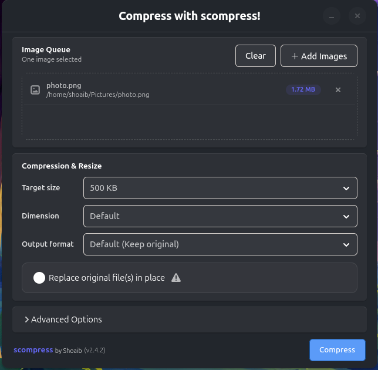
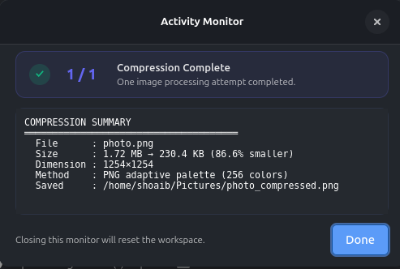

# scompress

**A local-first image compressor for Linux, with a standalone CLI and a native GTK 4 desktop app.**

> **scompress by Shoaib** — compress images on your own machine. Your files are not uploaded to a third-party service.



## Highlights

- **Target-size compression:** aim for a strict maximum size such as `--500` (500,000 bytes).
- **Common image formats:** JPEG, PNG, GIF (including animation), and static WebP.
- **Format conversion:** convert supported images to WebP, JPEG, PNG, or GIF.
- **Batch processing:** process multiple files or recursively process a directory tree.
- **Native desktop interface:** C + GTK 4, using the display backend provided by your Linux desktop (Wayland or X11/XWayland).
- **File-manager actions:** GNOME Files (Nautilus) Scripts and KDE Dolphin service menu.
- **Privacy controls:** remove identifying metadata by default, preserve supported metadata when explicitly requested, or remove all metadata.
- **Safe output handling:** originals are preserved by default; normal output creation does not overwrite an existing file.
- **Opt-in in-place replacement:** staged output, source checks, recovery hard links, confirmation, and rollback attempts.
- **No cloud processing:** image data stays local.


## Compress Successful!



## Download a ready-to-install package

Prebuilt Linux x86-64 packages are published on the [GitHub Releases page](https://github.com/mrshoaibxbd/scompress/releases/latest). Download `scompress-2.4.2-linux-amd64.zip` for the easiest installation. It includes the CLI, GTK desktop application, file-manager integration, `install.sh`, `uninstall.sh`, and a dedicated end-user guide.

The command-line executable is statically linked and does not need Go, Python, or ImageMagick at runtime. The graphical application requires a host GTK 4 runtime (GTK 4.10 or newer) and the normal desktop display libraries. On Ubuntu/Debian, install the GTK runtime with:

```bash
sudo apt install libgtk-4-1
```

Extract the release ZIP, open a terminal in the extracted directory, and run:

```bash
chmod +x install.sh uninstall.sh
./install.sh
```

The package README and `USER_GUIDE.md` explain installation, desktop integration, CLI usage, and removal.

## Quick start

### CLI

```bash
scompress image.png --500
```

This writes a compressed copy beside the original, typically named `image_compressed.png`. The original is not modified.

### GUI

Launch the graphical application:

```bash
scompress-gui
```

You can also pass image paths:

```bash
scompress-gui ~/Downloads/photo.png
```

From a file manager, select one or more supported images, then choose **Compress with scompress** from the context menu. In GNOME Files, the action is under **Scripts**.

## Build from source

The project currently targets **Linux x86-64**.

### Build requirements

On Ubuntu or Debian:

```bash
sudo apt update
sudo apt install golang-go build-essential pkg-config libwebp-dev libgtk-4-dev
```

Requirements:

- Go 1.23 or newer
- GCC or another compatible C compiler
- `pkg-config`
- GTK 4.10 or newer development files
- libwebp development files, including static archives (`libwebp.a` and `libsharpyuv.a`)

Check the GTK version:

```bash
pkg-config --modversion gtk4
```

### Build and install

```bash
git clone https://github.com/mrshoaibxbd/scompress.git
cd scompress
chmod +x build.sh build-and-install.sh install.sh uninstall.sh
./build-and-install.sh
```

The combined build script runs the Go tests, builds the CLI, compiles the GTK interface, checks the outputs, and installs the per-user application.

To build without installing:

```bash
./build.sh
```

Build outputs are written to `dist/linux-amd64/` and are intentionally excluded from version control. The GitHub release workflow builds and attaches the Linux x86-64 binaries to tagged releases.

### Installed files

| Path | Purpose |
|---|---|
| `~/.local/bin/scompress` | Standalone command-line compressor |
| `~/.local/bin/scompress-gui` | Native GTK 4 desktop application |
| `~/.local/share/nautilus/scripts/Compress with scompress` | GNOME Files action |
| `~/.local/share/kio/servicemenus/scompress.desktop` | KDE Dolphin action |
| `~/.local/share/applications/com.shoaib.scompress.desktop` | Application-menu launcher |
| `~/.local/share/icons/hicolor/scalable/apps/scompress.svg` | Application icon |

The CLI is statically linked with libwebp. The GTK 4 GUI links against the host desktop's GTK/GLib and display libraries. This split keeps the CLI independent while integrating the GUI with the host desktop environment.

## CLI usage

The target size uses decimal kilobytes: `--500` means **500,000 bytes**.

```bash
# Compress to a maximum of 500 KB
scompress image.png --500

# Compress a JPEG to 300 KB
scompress photo.jpg --300

# Batch compression
scompress *.jpg --500

# Convert PNG to WebP
scompress photo.png --500 --format webp

# Compress a directory recursively
scompress ~/Pictures --500 --recursive --output ~/Pictures/Optimized

# Preview the result without writing files
scompress *.jpg --500 --dry-run

# Machine-readable JSON report
scompress *.jpg --500 --json

# Show supported options
scompress --help
```

### Main options

| Option | Description |
|---|---|
| `--500` | Maximum output size in decimal KB; replace 500 with the desired value |
| `--target 500` | Long form of the target-size option |
| `--quality 85` | Preferred maximum quality (20–95); the encoder may reduce quality to meet the target |
| `--no-resize` | Do not reduce image dimensions |
| `--max-width 1920` | Maximum output width |
| `--max-height 1080` | Maximum output height |
| `--format webp` | Convert to `webp`, `jpeg`, `png`, or `gif` |
| `--output DIR` | Write outputs to a selected directory |
| `--recursive` | Recursively scan input directories |
| `--no-metadata` | Remove all supported metadata |
| `--keep-metadata` | Preserve supported metadata where available (JPEG/PNG only) |
| `--first-frame` | Allow animated GIF input to be converted to a still format using its first frame |
| `--dry-run` | Show what would be written without creating output files |
| `--json` | Emit a machine-readable JSON report |
| `--version` | Print the version |

## Desktop interface

The GTK 4 interface provides:

- Image selection through the native file chooser and drag-and-drop.
- Target-size presets and a custom target size.
- Output-format selection.
- Quality and dimension settings.
- Metadata policy controls.
- Optional output-folder selection.
- An explicit confirmation before replacing original files.
- Per-file activity reporting and a detailed result log.

### Progress reporting

The activity window reports the number of files whose processing attempt has completed (for example, `2 / 5`). The spinner indicates that the current operation is still running. scompress does not display a fabricated percentage for codec work that it cannot measure accurately.

### Replacing originals

Replacement is disabled by default. When enabled, the GUI:

1. Requires the original output format and original folder.
2. Compresses to temporary staging directories beside the source files.
3. Verifies the source file identity and timestamps before replacement.
4. Creates recovery hard links before committing replacements.
5. Attempts to roll back already committed replacements if a later replacement fails.

This is a safety measure, not a substitute for a backup. Filesystems or hardware failures can still prevent rollback; the result log reports recovery paths when backups must be retained.

## Supported formats and limitations

| Format | Read | Write | Notes |
|---|---:|---:|---|
| JPEG / JPG | Yes | Yes | JPEG output supports quality search |
| PNG | Yes | Yes | Palette optimization is available |
| GIF | Yes | Yes | Animated GIF input/output is supported |
| WebP | Yes | Yes | Static WebP only |
| Animated WebP | No | No | Not currently supported |
| AVIF | No | No | Not currently supported |

Other limitations:

- The current release targets Linux x86-64; ARM builds are not provided.
- The GUI requires GTK 4.10 or newer at build and runtime.
- The GUI uses GTK's Wayland or X11/XWayland backend supplied by the host desktop.
- `--keep-metadata` is limited to supported JPEG and PNG metadata. Cross-format metadata preservation is not supported.

## Uninstall

From the source checkout:

```bash
./uninstall.sh
```

The uninstaller removes the scompress executables and per-user desktop integrations. It does not remove system packages or modify user image files.

## Development

- [Contributing guide](CONTRIBUTING.md)
- [Build notes](docs/BUILDING.md)
- [Security policy](SECURITY.md)
- [Support](SUPPORT.md)
- [Changelog](CHANGELOG.md)
- [Third-party notices](THIRD_PARTY_NOTICES.txt)

## License

The scompress project is licensed under the MIT License. See [`LICENSE`](LICENSE). The statically linked libwebp component retains its own BSD 3-Clause license; see [`THIRD_PARTY_NOTICES.txt`](THIRD_PARTY_NOTICES.txt).
